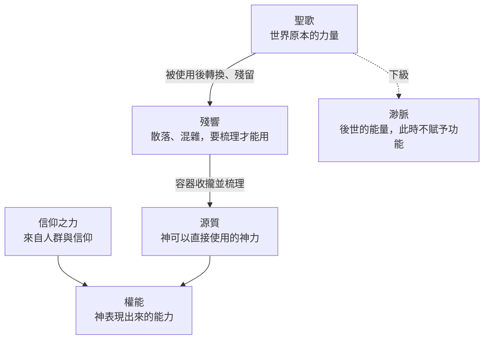

# 力量體系

## 總覽

## 聖歌

- 創世者留下的創世能量，能直接轉換質量與能量。
- 原本世界充滿聖歌。聖歌可以轉換成各種性質的力量，也會因為某些原因自行轉換。
- 在狂戰族之戰中重啟鎮神劍時幾乎耗盡。
- 最後一小部分保存在萬軍神歌裡。

## 殘響

- 聖歌被使用之後留下的轉換物與殘留，帶有各種性質。
- 性質類似核廢料：不能直接再用，要經過梳理。
- 聖歌耗盡之後，各種性質的殘響混雜散落在各地，擾亂世界的平衡。把殘響收攏、分類，就是神權之戰在世界層面的意義。
- 殘響有種類，彼此不通用，但大多可以轉換。同性質的容易吸收，不同性質的要先轉換。
- **規模感**可以用錢來理解：
  - 一般人身上都有一點，神看不上。
  - 身上有幾萬的人可以自認富有，他們對付不了真正的大戶，但可以互相爭奪。
  - 真正的大戶是幾百萬、幾千萬的等級。這個等級需要普通信眾與高階信眾聚在一起，形成神殿團體。
- 殘響會自然聚集，聚集的地點是**洞天福地**。

## 源質

- 梳理過的殘響，是神能直接使用的神力。
- 神權之戰主要的掠奪資源。
- 轉化成源質之後不會再散開。
- 正式名稱是「源質」。討論中出現過的原質、源能、源力都是同一個東西的舊稱。

## 容器

- 收攏殘響的個體或位置。
- 神位、神、神眷者都是容器。
- 專案名稱 vessel 就是容器。

## 信仰之力

- 來自人群與信仰的力量，俗稱願力。
- 和殘響是不同的系統，但同樣能成為神力，在戰爭結算時也計入分數。
- 願力由群體的意志決定，不受個人意志左右。

## 渺脈

- 聖歌的下級，與殘響同源，但是不同系統的概念。
- 在後世會發展成能量結晶與貨幣一類的用途，成為後世力量的基礎型態。
- 在神權之戰這個時代不賦予功能。收集渺脈的設施與以它為基礎的經濟體都是戰後才有的。
- 後世的規劃：留白。

## 權能

權能是神表現出來的能力。下面的三分法是草案。

| 類別 | 內容 | 誰掌握 |
| --- | --- | --- |
| 宇宙權能 | 時間、空間、創造、毀滅、原初能量 | 永庭族、龍族，以及地位等同永庭族的大神 |
| 自然權能 | 生命、死亡、靈魂、元素等，不需要社會行為就能產生 | 自然神 |
| 社會權能 | 律法、契約、財富、文化等 | 信仰神 |

- 掌握宇宙權能的大神依規則可以參加神權之戰，但對他們沒有意義，所以不打。一般參戰者只能取得下位權能。
- 這些大神的來歷：留白。
- 神權之戰時期權能比較單一，可以明確劃分；戰後才因為融合與分裂變得複雜。
