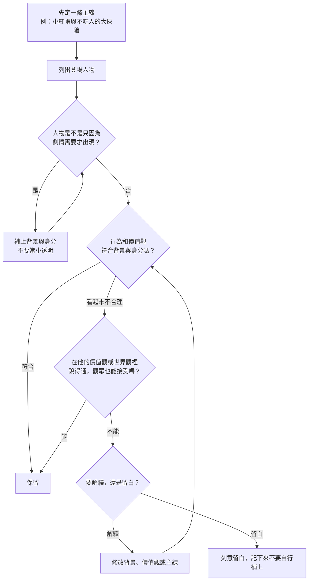
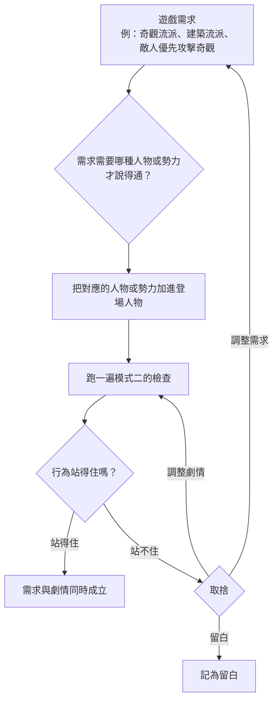

# 劇情設計的方法

整理自 2026-11-24 的討論（軒轅天芽、pomodorozhong）。這裡記的是**寫劇情的方法**，不是神權之戰的設定；設定在 [world-building/](world-building/README.md)。

## 前提

- 世界觀只佔遊戲很小的一部分。就算是視覺小說，世界觀也不必嚴謹，只要在劇情裡環環相扣就好。
- 這兩個模式都只針對劇情，不必百分之百遵守，依自己想要的劇情做取捨。
- 這兩個模式都**不是**軒轅天芽目前在用的方法。目前的方法比較接近先架一個 D&D 式的場子（細節還沒說明）。

## 模式一：從世界觀推出故事

世界觀造就人物的價值觀，價值觀造就人物的行為模式，人物的行為交織起來就是故事。

## 模式二：先寫故事，再讓人物站得住

先用一條主線把故事串起來，再依模式一的鏈條檢查每個人物。例如想寫「小紅帽與不吃人的大灰狼」，就先有這條主線，再跑一遍下面的流程，劇情就會有一定的深度。

- 人物的價值觀與行為要符合背景和身分，例如天真的公主、愛民的貴族、忠心的僕人、野心家。這些人物可以在同一個世界觀裡合理地同時出現。
- 人物有不合理的行為或奇怪的設定，只要放在他的價值觀或世界觀中是合理的，而且解釋能被觀眾理解、接受，就沒有問題。
- 阿吉專案走的是這個路子。
- 做到這些，基本上就滿足高規格劇情的條件。這是常見又簡單的做法，很多作品用的是劣化版本，差別頂多在有沒有先用一條主線串起來。

### 這個模式的好處

比起事後胡亂解釋，這個模式能**事先看出**哪些地方解釋不了，或者哪些地方留白不解釋比較好。對應到流程圖最下面的分支。

## 怎麼加入遊戲需求（尚未討論）

pomodorozhong 想知道模式二怎麼加入遊戲的需求來迭代。軒轅天芽認為可以做，但還沒有展開。下面是 Claude 依上面的流程**提出的草案**，不是討論的結論：

- 例：玩法上有「不愛戰爭、邊打邊蓋奇觀」的流派，劇情上就需要一個偏好和平、卻被捲入戰爭的勢力，他的價值觀要能解釋為什麼願意守奇觀而不主動掠奪。設定裡已有「偏好和平的族群」（見 [divine-war.md](world-building/divine-war.md)），可以從這裡開始檢查。
- 需求和劇情都可以讓步，原則仍是「依期望的劇情做取捨」。
